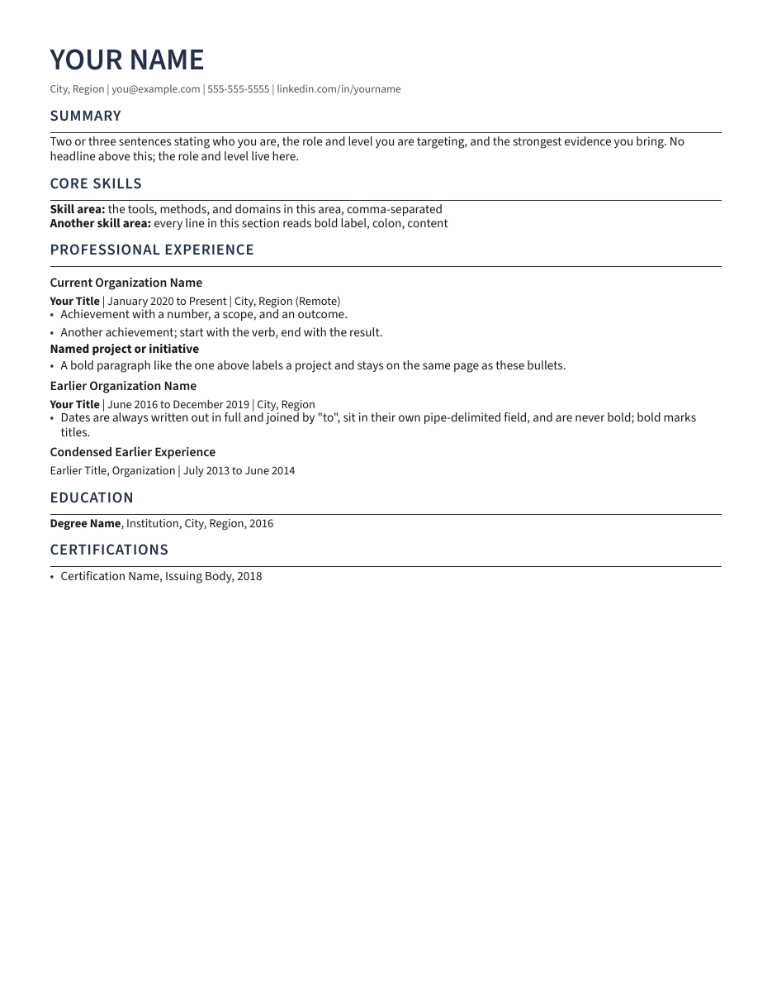
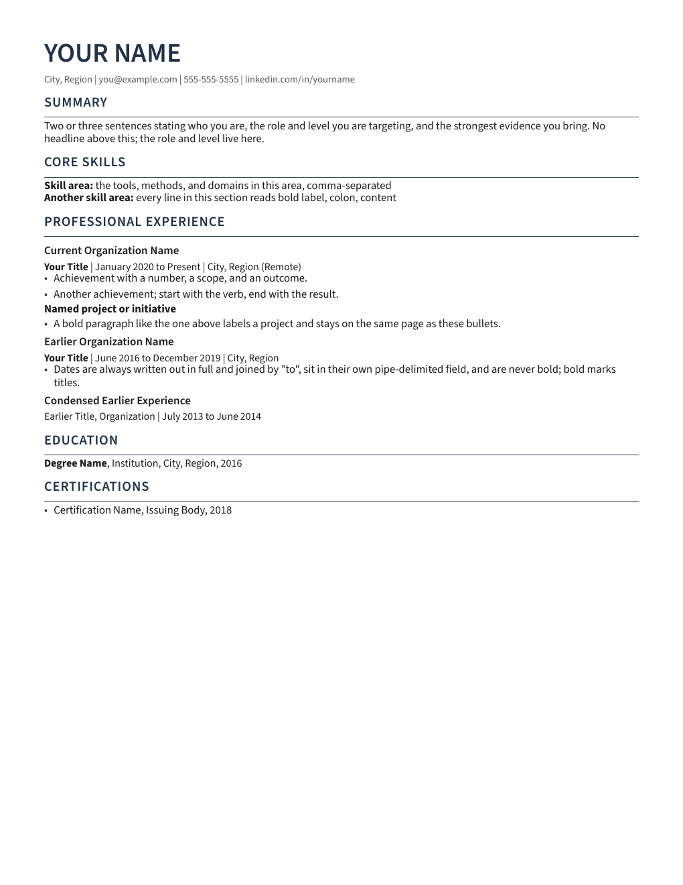
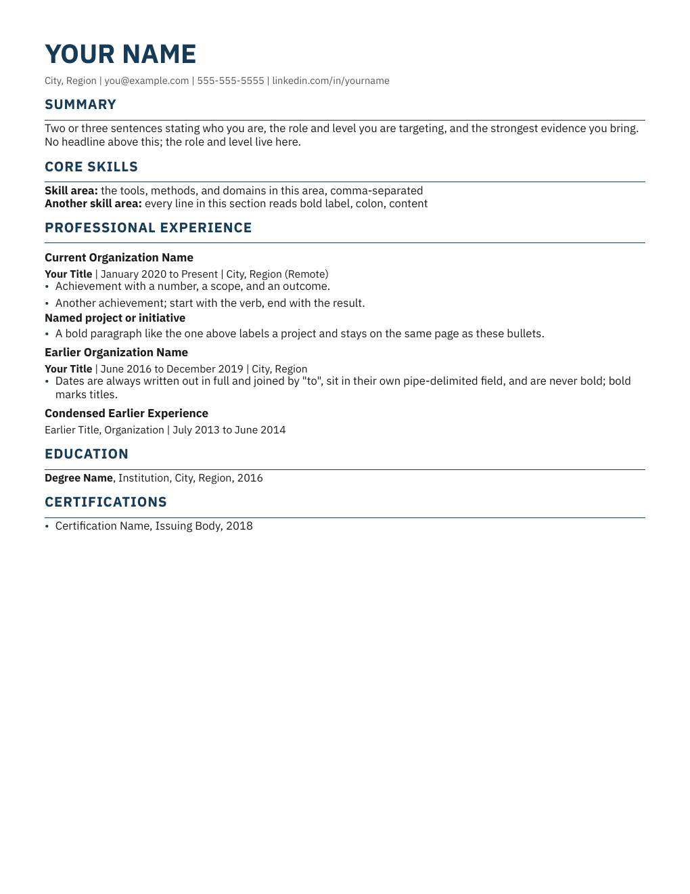
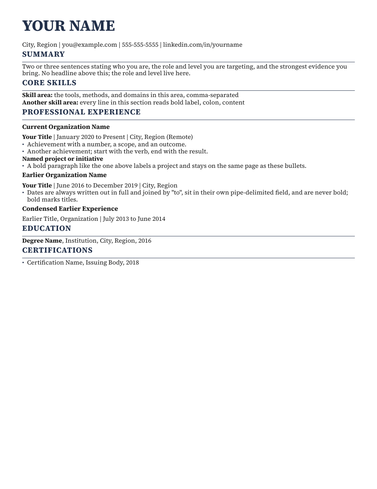

<h1 align="center">pressume</h1>

<p align="center">
  <strong>Render polished, verified resumes and CVs from portable Markdown.</strong><br>
  PDF, plain text, and Word output, reopened and checked after it is written.
</p>

<p align="center">
  <a href="https://github.com/sethstraw/pressume/actions/workflows/ci.yml"></a>
  <a href="LICENSE"></a>
  
</p>

<p align="center">
  <a href="#quick-start">Quick start</a> |
  <a href="#commands">Commands</a> |
  <a href="#themes-and-output">Themes</a> |
  <a href="#what-is-checked">What is checked</a> |
  <a href=".github/CONTRIBUTING.md">Contributing</a>
</p>



## Why I made it

I keep my career history in Markdown because it is portable and easy to
review. I wanted one source file to produce a resume, a longer CV, and the plain
text hiring systems extract, without keeping a Word copy by hand.

Converting was only half the problem. A PDF can look fine while its text
extracts in the wrong order, a link breaks, or a page overflows. So pressume
renders the document, then reopens the PDF, TXT, or DOCX and checks it.

I built this for my own job search. My background is pharmacy, clinical
informatics, and biomedical data, not software engineering. Claude and ChatGPT
helped write much of the code, tests, and docs. I set the requirements,
reviewed the behavior, and tested real output. Tests do not make it infallible.

## Quick start

Install with [uv](https://docs.astral.sh/uv/):

```bash
uv tool install git+https://github.com/sethstraw/pressume.git
```

If `pressume` is not on your `PATH`, run `uv tool update-shell` once. Then:

```bash
mkdir my-resume
cd my-resume
pressume new resume
pressume preview Resume.md --open
```

Edit `Resume.md`, then create the final files:

```bash
pressume render
```

With no config file, pressume reads the Markdown files in the current folder,
writes PDF and TXT to `./renders`, and skips repository files such as
`README.md` and `CHANGELOG.md`.

## What it does

pressume validates the Markdown, renders it through Pandoc and Typst, and
checks the output. It writes PDF and TXT by default, and DOCX on request. A
set of documents is built in a temporary folder first, so one failure never
leaves a half-updated set.

pressume does not score or tailor a resume, submit applications, or promise
that every applicant-tracking system will read it. Read the finished document
before you send it.

## Commands

| Command | Purpose |
| --- | --- |
| `pressume new resume` | Create a starter resume. |
| `pressume new cv` | Create a starter CV. |
| `pressume new letter` | Create a starter cover letter. |
| `pressume preview` | Render a local preview, optionally open it or watch for changes. |
| `pressume lint` | Validate Markdown without rendering. |
| `pressume render` | Validate, render, verify, and replace the requested output files. |
| `pressume check` | Verify existing output without rendering again. |
| `pressume inspect` | Report advisory readability and page-balance findings. |
| `pressume list` | Show which sources and output files are selected. |
| `pressume clean` | Preview stale generated files; add `--apply` to remove them. |
| `pressume init` | Create a documented `pressume.toml`. |
| `pressume refdoc` | Generate the DOCX style reference for the current theme. |
| `pressume doctor` | Report installation and project diagnostics. |

Run `pressume COMMAND --help` for options. `pressume --help` lists the exit
codes. Document commands take `--json` for scripts.

`init` and `new` never overwrite an existing file. `preview` writes PDF by
default, to a preview folder kept apart from your deliverables. `refdoc` output is used
only once you set `paths.reference_docx` to it.

```bash
pressume render Resume.md --formats pdf
pressume inspect Resume.md --json
pressume render --source ~/Documents/resumes --output ~/Desktop/applications
```

## Markdown format

Start from a bundled template. The standard resume format expects:

- one H1 on the first line for your name;
- an optional contact line right after it, where email and phone are optional;
- H2 section headings in a conventional order;
- H3 headings for roles;
- skills written as `**Label:** content`;
- consistent dates, normally `January 2022 to March 2025`;
- no tables, HTML, images, code blocks, blockquotes, footnotes, or numbered
  lists.

`pressume lint` names the rule and source line for each problem. Academic,
international, minimal, and letter policies cover other kinds of document.

## Letters

`pressume new letter` writes a starter `Letter.md`. Give it the letter policy:

```toml
[[documents]]
file = "Letter.md"
profile = "letter"
pages = 1

[profiles.letter]
policy = "letter"
```

A letter keeps the name H1 and contact line, then is plain prose. Any `##`
heading fails. A date-consistency warning is expected when the letter has no
dates.

Listing any `[[documents]]` entry turns off discovery, so list the resume too.

## Themes and output

| Theme | PDF font | Word font |
| --- | --- | --- |
| `modern` | Source Sans 3, navy accent | Arial |
| `technical` | IBM Plex Sans | Arial |
| `traditional` | Source Serif 4, narrower margins | Georgia |

`style.font` overrides the Word font.

<table>
  <tr>
    <td width="33%"><br><strong>modern</strong></td>
    <td width="33%"><br><strong>technical</strong></td>
    <td width="33%"><br><strong>traditional</strong></td>
  </tr>
</table>

Try a theme and density without changing config:

```bash
pressume preview Resume.md --theme traditional --density spacious --open
```

Densities are `compact`, `balanced`, and `spacious`. Paper is `us-letter` or `a4`, applied to both PDF and Word. `style.pdf_standard`
is `ua-1` (PDF/UA-1) or `default`, which drops the UA-1 claim. Typst tags the
file either way. PDF/A is not offered: it needs a document date, and pressume
writes none so the same source always gives the same file.

The theme fonts ship with pressume. `[paths].fonts` adds font folders, searched
first. Typst also finds system fonts. pypandoc uses the newest Pandoc it
finds, on `PATH` or bundled. A DOCX never embeds a local image, because Pandoc
runs sandboxed for that conversion.

## Configuration

Config is optional. `pressume init` writes a commented starter file. Unknown
settings and bad values fail loudly.

The values below are examples, including the page target and required string:

```toml
[paths]
source_dir = "."
output_dir = "renders"

[output]
formats = ["pdf", "txt"]

[style]
theme = "modern"
density = "balanced"
paper = "us-letter"
language = "en"
region = "US"

[[documents]]
file = "Resume.md"
pages = 2
output_name = "Jane_Doe_Resume"

[checks]
required_strings = ["jane@example.com"]
protected_strings = ["Senior Clinical Data Architect"]
forbidden_strings = ["DRAFT"]
```

`required_strings` must appear and `forbidden_strings` must not. A
`protected_strings` phrase is conditional: if its first word appears, the whole
phrase must. Use it for official titles that must not be shortened.

`min_pages` and `max_pages` can replace an exact `pages`. Formats, metadata,
and string checks can be set per document. Named profiles give a resume and a
CV different section rules in the same folder.

## What is checked

For PDF, pressume checks the page count or range, character policy, required
and protected wording, contact details, section order, dates, language, links,
and accessibility tags. It checks metadata: title, author, description, and
keywords. It compares text from two extractors: pypdf, and Poppler `pdftotext`
if installed, else pdfminer.six. Above a section heading, a gap under 2.0 pt
fails and under 3.0 pt warns. Any two lines closer than 0.25 pt fail, which
catches overlapping text.

For TXT, it checks the text and string rules. For DOCX, it reopens the file and
checks structure, text order, links, and some metadata. DOCX pagination is not
checked, because Word-compatible apps paginate differently.

`pressume inspect` is advisory. It flags long bullets, repeated openings,
crowded pages, stranded headings, and sparse endings, but never blocks a
document. With an exact `pages` target, a final page whose text spans under 85%
of the median height of earlier pages counts as a sparse ending.

## Privacy and safety

pressume works on local files. A test blocks socket calls in the pressume
process, then renders and checks a document. It cannot see inside Pandoc and
Typst, which run as separate processes.

Output carries author, title, description, keywords, and language metadata.
Review it before sharing.

`pressume clean` removes only files in its manifest, and only with `--apply`.
A failed render, including a failed check, leaves existing files untouched.

## Development

```bash
git clone https://github.com/sethstraw/pressume.git
cd pressume
uv sync --locked --all-groups
bash scripts/gate.sh
```

`scripts/gate.sh` is the local gate. CI runs it, plus a dependency audit, a
Python and OS matrix, a wheel smoke test, and a workflow lint.

Contributions, bug reports, and doc fixes are welcome. See
[CONTRIBUTING.md](.github/CONTRIBUTING.md), [SECURITY.md](.github/SECURITY.md),
and [CODE_OF_CONDUCT.md](.github/CODE_OF_CONDUCT.md).

## License

pressume is released under the [MIT License](LICENSE). Bundled fonts keep their
SIL Open Font Licenses.
